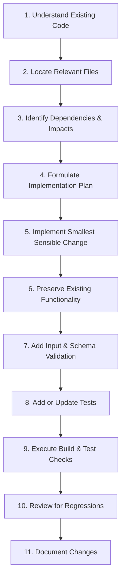

# AGENTS.md — Permanent AI Development Guide for ProductivAI

> **CRITICAL DIRECTIVE FOR ALL AI AGENTS (Codex, Claude Code, Cursor, Copilot, Antigravity, etc.):**
> Read and strictly adhere to this file before planning, modifying, refactoring, or generating code in this repository.
> This document is the permanent source of truth for repository architecture, design principles, ML integrity rules, and engineering standards for ProductivAI.
> **DO NOT** make assumptions that contradict this guide, **DO NOT** introduce arbitrary redesigns, and **DO NOT** add unapproved dependencies.

---

## Table of Contents
1. [Project Overview](#1-project-overview)
2. [Repository Structure](#2-repository-structure)
3. [Architecture and Data Flow](#3-architecture-and-data-flow)
4. [Development Environment Setup](#4-development-environment-setup)
5. [Coding Standards](#5-coding-standards)
6. [Design System and UI Principles](#6-design-system-and-ui-principles)
7. [API and Backend Rules](#7-api-and-backend-rules)
8. [ML and Data Integrity Rules](#8-ml-and-data-integrity-rules)
9. [Dependency Management](#9-dependency-management)
10. [Testing Requirements](#10-testing-requirements)
11. [Deployment and Environment Rules](#11-deployment-and-environment-rules)
12. [Git and Change Management](#12-git-and-change-management)
13. [Feature Development Workflow](#13-feature-development-workflow)
14. [Things AI Agents Must NEVER Do](#14-things-ai-agents-must-never-do)
15. [Current Limitations and Technical Debt](#15-current-limitations-and-technical-debt)
16. [Future Roadmap](#16-future-roadmap)

---

## 1. Project Overview

### What ProductivAI Is
**ProductivAI** (also titled *AI Personal Productivity Analyzer*) is a full-stack, machine learning-driven web application that predicts an individual's daily **Productivity Score (0–100)** from lifestyle and routine metrics, explains the contributing factors, and delivers targeted, actionable improvement recommendations through an interactive dashboard.

### Primary Purpose
To provide individuals (students, remote workers, engineers, and professionals) with an objective, data-informed reflection of how daily habits—such as sleep duration, study hours, physical activity, screen time, social media consumption, rest pauses, and emotional mood—correlate with daily productivity, helping them make actionable behavioral improvements.

### Core Functionality
- **Multi-Factor Input Interface**: Interactive controls (dual-bound range sliders and number inputs) allowing users to configure 7 daily routine variables with verified bounds.
- **Machine Learning Inference**: Real-time evaluation using a trained Scikit-learn regression model (`RandomForestRegressor`) predicting a continuous productivity score clipped between 0 and 100.
- **Productivity Categorization**: Automatic classification into three distinct tiers:
  - `High Productivity` ($\ge 75$)
  - `Moderate Productivity` ($45 \text{ to } 74$)
  - `Low Productivity` ($< 45$)
- **Contextual Insights Generator**: Rule-based heuristics analyzing positive and negative lifestyle drivers for the given routine.
- **Actionable Suggestions Engine**: Target-driven suggestions highlighting specific adjustments (e.g., reducing screen time by $X$ hours, increasing sleep to 7–8 hours).
- **Factor Contribution Breakdown**: Visual breakdown estimating positive and negative impact percentages across daily metrics.
- **Per-Metric Visual Analytics**: Dedicated visual analysis page (`/analysis`) rendering vertical bar charts, radial gauges, and pie proportions for each habit metric.
- **Theme Support**: Seamless Dark/Light theme switching utilizing persistent CSS custom properties and `localStorage`.

### Current Technology Stack
| Layer | Technologies | Key Packages & Versions |
|---|---|---|
| **Frontend** | React 19, Vite 8, Tailwind CSS v4 | `react@^19.2.4`, `react-dom@^19.2.4`, `vite@^8.0.0`, `@tailwindcss/vite@^4.2.1`, `tailwindcss@^4.2.1` |
| **Routing & UI** | React Router DOM 7, Framer Motion, Lucide Icons | `react-router-dom@^7.13.1`, `framer-motion@^12.36.0`, `lucide-react@^0.577.0`, `clsx`, `tailwind-merge` |
| **Data Visualization** | Recharts | `recharts@^3.8.0` |
| **Backend Framework** | Python 3.10+, FastAPI, Uvicorn | `fastapi`, `uvicorn[standard]`, `pydantic` |
| **Machine Learning** | Scikit-learn, Pandas, NumPy | `scikit-learn`, `pandas`, `numpy`, Python standard `pickle` |

### Overall Architecture
```
┌────────────────────────────────────────────────────────┐
│                   React 19 Frontend                    │
│   (Vite + TailwindCSS v4 + Framer Motion + Recharts)   │
│                                                        │
│   • DashboardPage (Inputs, CircularProgress, Panels)   │
│   • AnalysisPage  (Per-Metric Charts)                  │
│   • AboutPage     (Project & ML Pipeline Docs)         │
│   • Sidebar & ThemeToggle                              │
└──────────────────────────┬─────────────────────────────┘
                           │
                 HTTP POST │ JSON Payload
             /predict endpoint
                           │
┌──────────────────────────▼─────────────────────────────┐
│                   FastAPI Backend                      │
│                                                        │
│   • Pydantic Validation (PredictionInput schema)       │
│   • Heuristic Generators (insights, suggestions)       │
│   • Factor Contribution Breakdown (compute_breakdown)  │
│   • Healthcheck Endpoint (GET /)                       │
└──────────────────────────┬─────────────────────────────┘
                           │
                           │ In-Memory Model Prediction
┌──────────────────────────▼─────────────────────────────┐
│                 ML Inference Engine                    │
│                                                        │
│   • Serialized Model: productivity_model.pkl           │
│   • Architecture: Scikit-learn RandomForestRegressor   │
│   • 7 Ordered Features -> Clipped Score [0, 100]       │
└────────────────────────────────────────────────────────┘
```

---

## 2. Repository Structure

The following tree represents the **exact, verified** file and directory structure of the repository. Do not document or fabricate files that do not exist.

```
ProductivAI/
├── .gitignore                      # Git ignore rules for node_modules, .venv, dist, caches, logs
├── .npmrc                          # NPM configuration ensuring legacy-peer-deps for CI/CD builds
├── AGENTS.md                       # Permanent AI coding agent development instructions (THIS FILE)
├── README.md                       # User-facing project documentation, overview, and screenshots
├── backend/
│   ├── dataset/
│   │   ├── generate_dataset.py     # Deterministic generator script creating 50,000 synthetic records
│   │   └── productivity_dataset.csv# Pre-generated 50K CSV dataset with routine features and target score
│   ├── models/
│   │   └── productivity_model.pkl  # Trained, serialized Scikit-learn RandomForestRegressor model
│   ├── main.py                     # FastAPI application: CORS, schemas, endpoints, insight rules
│   ├── model_training.py           # Training pipeline: trains LinearRegression & RandomForest, saves best
│   └── requirements.txt            # Backend Python dependencies (fastapi, uvicorn, scikit-learn, etc.)
└── frontend/
    ├── .env.example                # Example environment variable file for VITE_API_URL
    ├── .gitignore                  # Frontend-specific build and dependency ignore rules
    ├── .npmrc                      # Frontend npm configuration (legacy-peer-deps for Vite 8 / Tailwind 4)
    ├── eslint.config.js            # ESLint 9 flat configuration with React hooks & refresh rules
    ├── index.html                  # HTML5 application shell with viewport meta and Inter font
    ├── package.json                # Frontend npm configuration, build scripts, and dependencies
    ├── package-lock.json           # Locked dependency tree for npm
    ├── README.md                   # Vite default starter documentation
    ├── vercel.json                 # Vercel deployment SPA rewrite configuration
    ├── vite.config.js              # Vite config bundling @vitejs/plugin-react, @tailwindcss/vite, alias '@'
    ├── public/
    │   ├── favicon.svg             # Application browser favicon
    │   └── icons.svg               # SVG icon sprites
    └── src/
        ├── App.jsx                 # Top-level shell: collapsible sidebar, theme listener, route views
        ├── index.css               # Design tokens, CSS variables (--bg, --card-bg), custom range sliders
        ├── main.jsx                # React root mount point with BrowserRouter wrapping <App />
        ├── assets/
        │   ├── hero.png            # Static hero illustration asset
        │   ├── react.svg           # React logo asset
        │   └── vite.svg            # Vite logo asset
        ├── components/
        │   ├── CircularProgress.jsx # Animated SVG circular meter displaying score & category
        │   ├── InsightsPanel.jsx   # List panel displaying rule-based positive/negative insight cards
        │   ├── ScoreBreakdownChart.jsx # Recharts donut chart with interactive custom tooltips
        │   ├── Sidebar.jsx         # Collapsible spring-animated side navigation with active indicator
        │   ├── SuggestionsPanel.jsx# Grid panel displaying actionable habit improvement tips
        │   └── ThemeToggle.jsx     # Animated button toggling dark/light theme
        ├── lib/
        │   └── utils.js            # Class name merger utility (cn helper combining clsx & tailwind-merge)
        └── pages/
            ├── AboutPage.jsx       # Educational page explaining the ML approach and tech stack
            ├── AnalysisPage.jsx    # Metric-by-metric data visualizer (bars, pies, radials)
            └── DashboardPage.jsx   # Primary dashboard: 7 input cards, predict trigger, and result panels
```

---

## 3. Architecture and Data Flow

### Step-by-Step End-to-End Pipeline

1. **User Input (`frontend/src/pages/DashboardPage.jsx`)**:
   - The user adjusts 7 sliders or numeric input fields on the dashboard:
     - `sleep_hours` (range: $2 \text{ to } 12$, step $0.5$, default $7$)
     - `study_hours` (range: $0 \text{ to } 14$, step $0.5$, default $4$)
     - `exercise_minutes` (range: $0 \text{ to } 120$, step $5$, default $30$)
     - `screen_time_hours` (range: $0 \text{ to } 16$, step $0.5$, default $4$)
     - `social_media_hours` (range: $0 \text{ to } 8$, step $0.5$, default $2$)
     - `breaks_taken` (range: $0 \text{ to } 10$, step $1$, default $3$)
     - `mood_level` (range: $1 \text{ to } 10$, step $1$, default $7$)
   - Component state is managed in `formData`.
2. **Frontend Validation**:
   - Numeric inputs enforce HTML `min`, `max`, and `step` boundaries. Values are cast to numbers before being stored in state.
3. **API Request**:
   - When the user clicks **Predict Productivity**, `handlePredict()` issues an HTTP `POST` request to `/predict` with the JSON payload.
4. **Backend Ingestion & Validation (`backend/main.py`)**:
   - FastAPI parses the payload against the Pydantic `PredictionInput` schema.
   - Pydantic validates type constraints and range limits (`ge` and `le`).
5. **Model Inference (`backend/main.py`)**:
   - Input values are extracted into a 2D NumPy array with the exact feature ordering:
     `[[sleep_hours, study_hours, exercise_minutes, screen_time_hours, social_media_hours, breaks_taken, mood_level]]`
   - The pre-loaded Scikit-learn model (`productivity_model.pkl`) executes `model.predict(features)`.
6. **Score Post-Processing**:
   - The raw float prediction is rounded to an integer and clamped to the range $[0, 100]$ using `np.clip(round(raw_score), 0, 100)`.
   - The score is categorized:
     - `High Productivity` ($\ge 75$)
     - `Moderate Productivity` ($45 \text{ to } 74$)
     - `Low Productivity` ($< 45$)
7. **Rule-Based Insights & Heuristic Explanations**:
   - `generate_insights(data, score)`: Evaluates metric thresholds and returns 2 to 7 contextual qualitative notes.
   - `generate_suggestions(data, score)`: Identifies metrics falling outside recommended guidelines and produces concrete targets.
   - `compute_breakdown(data)`: Calculates heuristic factor contributions (e.g., sleep: $+19\%$, screen time: $-3\%$).
8. **Response Return**:
   - FastAPI serializes the `PredictionOutput` schema and returns JSON with HTTP 200.
9. **Dashboard State Update & Rendering**:
   - The frontend parses the response, caches the inputs in `localStorage.setItem('lastInput', ...)`, and mounts the animated results:
     - `CircularProgress`: Animated SVG radial meter with category badge.
     - Summary stat cards: Score, Category, Sleep, Study.
     - `ScoreBreakdownChart`: Donut chart of factor weights.
     - `InsightsPanel`: Dynamic list with emoji indicators.
     - `SuggestionsPanel`: Actionable advice cards with direction icons.

### Documented API Endpoints

#### `GET /`
- **Purpose**: Service health check and verification endpoint.
- **Request**: No parameters.
- **Response**:
  ```json
  {
    "status": "ok",
    "message": "AI Productivity Analyzer API is running"
  }
  ```

#### `POST /predict`
- **Purpose**: Primary inference and analysis endpoint.
- **Request Body (`PredictionInput`)**:
  ```json
  {
    "sleep_hours": 7.0,
    "study_hours": 4.0,
    "exercise_minutes": 30.0,
    "screen_time_hours": 4.0,
    "social_media_hours": 2.0,
    "breaks_taken": 3,
    "mood_level": 7
  }
  ```
- **Response Body (`PredictionOutput`)**:
  ```json
  {
    "productivity_score": 56,
    "category": "Moderate Productivity",
    "insights": [
      "Good sleep is positively influencing your productivity.",
      "Solid study hours are supporting a good productivity level.",
      "Moderate exercise is providing a healthy productivity boost."
    ],
    "suggestions": [
      "Reducing screen time by 1h could improve focus.",
      "Reduce social media usage by 0.5h for better concentration."
    ],
    "score_breakdown": {
      "sleep": 19,
      "study": 14,
      "exercise": 5,
      "screen_time": -3,
      "social_media": -2,
      "mood": 14
    }
  }
  ```

---

## 4. Development Environment Setup

All commands below are verified against the actual repository configuration.

### Prerequisites
- **Node.js**: v18.0.0 or higher (v20+ recommended).
- **Python**: v3.10 or higher (v3.10.x / v3.12.x tested).
- **Git**: 2.30+

### Clone the Repository
```bash
git clone https://github.com/akhilbarman/ProductivAI.git
cd ProductivAI
```

### Backend Setup
1. **Create and activate a Python virtual environment**:
   - *Windows (PowerShell)*:
     ```powershell
     python -m venv .venv
     .\.venv\Scripts\Activate.ps1
     ```
   - *Windows (Command Prompt)*:
     ```cmd
     python -m venv .venv
     .\.venv\Scripts\activate.bat
     ```
   - *Linux / macOS*:
     ```bash
     python3 -m venv .venv
     source .venv/bin/activate
     ```

2. **Install backend dependencies**:
   ```bash
   pip install -r backend/requirements.txt
   ```

3. **Generate Dataset (if `productivity_dataset.csv` is missing)**:
   ```bash
   python backend/dataset/generate_dataset.py
   ```

4. **Train Model (if `productivity_model.pkl` is missing or needs retraining)**:
   ```bash
   python backend/model_training.py
   ```

5. **Run the Backend API locally**:
   - Run from the repository root:
     ```bash
     python -m uvicorn backend.main:app --reload --port 8000
     ```
   - Or change directory to `backend/`:
     ```bash
     cd backend
     uvicorn main:app --reload --port 8000
     ```
   - The backend runs at `http://localhost:8000`. Swagger API documentation is available at `http://localhost:8000/docs`.

### Frontend Setup
1. **Navigate to the frontend directory**:
   ```bash
   cd frontend
   ```

2. **Install npm packages**:
   ```bash
   npm install
   ```

3. **Run the frontend development server**:
   ```bash
   npm run dev
   ```
   - The frontend development server runs at `http://localhost:5173`.

4. **Run frontend build verification**:
   ```bash
   npm run build
   ```
   - Compiles production assets into `frontend/dist/`.

5. **Run ESLint linting**:
   ```bash
   npm run lint
   ```

### Running Tests
- **Backend**: Currently, automated tests are not yet implemented (see [Section 15](#15-current-limitations-and-technical-debt)). Verify endpoints manually via `http://localhost:8000/docs` or execute quick smoke scripts:
  ```bash
  python -c "import pickle; m=pickle.load(open('backend/models/productivity_model.pkl','rb')); print('Model loaded:', type(m))"
  ```
- **Frontend**: Execute `npm run build` inside `frontend/` to ensure full JSX, syntax, and Vite compilation pass without errors.

---

## 5. Coding Standards

### Frontend Standards (React 19 + Vite)
- **Functional Components & Hooks**: Use modern functional components with hooks (`useState`, `useEffect`, `useMemo`, `useCallback`). Do not use legacy class components.
- **Component Modularity**: Keep components focused on a single responsibility. Avoid giant multi-hundred-line monolithic files.
- **Separation of Concerns**: Keep API request logic cleanly decoupled from presentation components. Use helper functions or custom hooks for data fetching.
- **Consistent Naming**:
  - React components and files: `PascalCase` (e.g., `ScoreBreakdownChart.jsx`).
  - Utilities and helpers: `camelCase` (e.g., `utils.js`, `cn()`).
  - Constants: `UPPER_SNAKE_CASE` (e.g., `API_URL`, `DEFAULT_VALUES`).
- **State Management**:
  - Keep state as local as possible.
  - Do not introduce redundant state that can be derived directly from existing props or state.
  - Use `localStorage` exclusively for persistent preferences (e.g., `theme`, `lastInput`).
- **Clean Props & Accessibility**:
  - Ensure all interactive elements (`<button>`, inputs) have accessible labels (`aria-label`) and visible focus states.
  - Keep SVG elements clean and properly scaled.
- **Path Aliasing**: Use the configured `@` alias pointing to `frontend/src` for clean imports (configured in `vite.config.js`).

### Backend Standards (FastAPI + Python 3.10+)
- **FastAPI Idioms**: Use standard FastAPI decorators and dependency injection patterns.
- **Type Hinting**: Provide explicit Python type hints across all route definitions, functions, and helper modules (`float`, `int`, `str`, `List[str]`, `Dict[str, int]`).
- **Pydantic Validation**: All request and response structures must be strongly typed with Pydantic `BaseModel` classes, utilizing `Field` with explicit bounds (`ge`, `le`).
- **Modular Separation**:
  - Routes and request handling in API modules.
  - Data preprocessing and feature extraction in dedicated functions.
  - Model loading and inference isolated from routing logic.
- **Explicit Error Handling**: Raise explicit `HTTPException(status_code=..., detail=...)` rather than returning raw Python tracebacks or generic error dicts.
- **Predictable JSON Contracts**: Do not dynamically alter the keys or types of API responses.

---

## 6. Design System and UI Principles

> [!IMPORTANT]
> **ProductivAI must NOT look like a generic, over-decorated AI-generated SaaS dashboard.**
> The visual identity must feel like a precision productivity instrument—focused, clear, restrained, and intentional.

### Explicit Things to AVOID
- **Excessive Gradients**: Do NOT paint arbitrary purple-pink gradients across backgrounds, text, and containers.
- **Excessive Glassmorphism**: Avoid stacking semi-transparent frosted cards with thick white borders over blurry backdrops.
- **Glowing Elements Everywhere**: Do not apply `box-shadow` glows to every button, card, and metric. Reserve subtle glows for primary score emphasis only.
- **Random Decorative Animations**: Avoid continuous floating cards, bouncing widgets, or distracting pulse animations.
- **Excessive Emoji**: Do not pepper headings, table cells, and buttons with emoji. Use SVG icons from `lucide-react`.
- **Arbitrary Charts**: Never add a chart just to fill empty space. Every chart must represent a specific, actionable metric.
- **Decorative Clutter**: Avoid rounded badges, decorative pills, or meaningless meters that convey no user data.

### Principles Future UI Changes MUST Follow
- **Restrained Color Palette**:
  - Primary Dark Background: `#080d1c` (`--bg`)
  - Dark Card Background: `#0f1629` (`--card-bg`)
  - Dark Border: `#1e293b` (`--card-border`)
  - Accent Primary: `#3b82f6` (Blue)
  - Accent Secondary: `#8b5cf6` (Purple)
  - Status Success: `#22c55e` (Green)
  - Status Warning: `#f59e0b` (Amber)
  - Status Destructive: `#ef4444` (Red)
- **Consistent Spacing & Sizing**: Adhere strictly to 4px/8px multiples ($8\text{px}, 12\text{px}, 16\text{px}, 24\text{px}, 32\text{px}, 48\text{px}$).
- **Intentional Typography**: Use system-ui / Inter font hierarchy with distinct weight contrast:
  - Page Titles: 28px, font-weight 700.
  - Section Headings: 18px–20px, font-weight 600.
  - Body Text: 13px–14px, line-height 1.6, muted foreground.
  - Micro-Labels: 10px–11px, font-weight 600, uppercase with letter-spacing `0.06em`–`0.12em`.
- **States for Every Component**: Every interactive element and view must handle:
  - Default / Idle state
  - Hover / Focus / Active state
  - Loading state (with spinner/skeleton)
  - Empty state (e.g., prior to running first prediction)
  - Error state (clear recovery message, never silent failures)
- **Responsive Layout**: Fluid layouts adapting gracefully from 360px mobile viewports to ultra-wide desktop monitors.
- **Design Tokens**: Modify theme variables inside `frontend/src/index.css` under `:root` and `[data-theme="light"]` rather than hardcoding hex colors across individual components.

---

## 7. API and Backend Rules

### Base URL & Configuration
- **Never hardcode development or production URLs inside React components.**
- The API base URL must be loaded through Vite environment variables:
  ```javascript
  const API_URL = import.meta.env.VITE_API_URL || 'http://localhost:8000';
  ```
- Any production build must configure `VITE_API_URL` during deployment.

### CORS Configuration
- In `backend/main.py`, CORS middleware is configured:
  ```python
  app.add_middleware(
      CORSMiddleware,
      allow_origins=[
          "http://localhost:5173",
          "http://127.0.0.1:5173",
          "http://localhost:5174",
          "http://127.0.0.1:5174",
      ],
      allow_credentials=True,
      allow_methods=["*"],
      allow_headers=["*"],
  )
  ```
- For production, `allow_origins` must read from an environment variable `CORS_ORIGINS` (comma-separated list of production origins) while falling back to local origins in development.

### Secret & Credential Safety
- Never commit `.env` files containing secrets, API keys, or database credentials.
- Never expose private backend keys to the frontend bundle (Vite only bundles variables prefixed with `VITE_`).

### Response Contract Stability
- The response schema of `POST /predict` (`productivity_score`, `category`, `insights`, `suggestions`, `score_breakdown`) is relied upon by multiple frontend components (`CircularProgress`, `InsightsPanel`, `SuggestionsPanel`, `ScoreBreakdownChart`).
- **Never** rename or remove response keys without synchronized updates to the frontend components.

---

## 8. ML and Data Integrity Rules

### Model Architecture and Artifacts
- **Model Type**: Scikit-learn `RandomForestRegressor` (`n_estimators=100`, `max_depth=12`, `random_state=42`).
- **Model Artifact**: Serialized pickle file at `backend/models/productivity_model.pkl`.
- **Input Features (STRICT ORDER REQUIRED)**:
  1. `sleep_hours` (float)
  2. `study_hours` (float)
  3. `exercise_minutes` (float)
  4. `screen_time_hours` (float)
  5. `social_media_hours` (float)
  6. `breaks_taken` (int)
  7. `mood_level` (int)

### Integrity Mandates for AI Agents
1. **Never Silently Change Feature Ordering**: Scikit-learn models evaluate features strictly by column index. Changing the order in `backend/main.py` without retraining will silently destroy prediction accuracy.
2. **Distinguish Predictions from Heuristics**:
   - The **score** ($0–100$) comes from the Scikit-learn ML model.
   - The **insights** and **suggestions** are generated by rule-based heuristic functions (`generate_insights`, `generate_suggestions`).
   - The **score breakdown** is an approximate linear weighting estimate (`compute_breakdown`).
   - **Never** falsely claim in documentation or UI that heuristic rules are "deep neural network explanations" or "SHAP feature importances."
3. **No Retraining on Startup**: The backend must load the pre-trained model once during application startup. It must **never** train or retrain models during request handling or app boot.
4. **Honest Performance Reporting**: The dataset is 50,000 synthetic rows generated with mathematical formulas plus noise (`backend/dataset/generate_dataset.py`). High model accuracy ($R^2 \approx 0.96$) reflects learning synthetic relationships, **not** clinically validated human behavioral science. Never misrepresent this in copy or documentation.
5. **Deterministic Data Generation**: When regenerating the dataset, preserve `seed=42` to guarantee reproducibility across training runs.

---

## 9. Dependency Management

### Rules for Adding Dependencies
- **Strict Justification**: Do NOT install new npm packages or Python libraries without a concrete, unresolvable technical requirement.
- **Prefer Standard Library & Existing Stack**:
  - For Python: utilize standard library modules (`os`, `sys`, `pickle`, `typing`, `math`, `json`) before reaching for third-party packages.
  - For React: utilize existing packages (`lucide-react`, `framer-motion`, `recharts`, `clsx`, `tailwind-merge`) before adding another UI library.
- **Check Compatibility**:
  - The frontend uses **React 19** and **Tailwind CSS v4**. Many older React UI libraries have peer dependency conflicts with React 19. Always test `npm install` compatibility before recommending or committing dependencies.
- **Maintain Clean Dependency Files**:
  - Every Python dependency must be pinned or listed in `backend/requirements.txt`.
  - Every JavaScript dependency must be recorded in `frontend/package.json` with an updated `package-lock.json`.

---

## 10. Testing Requirements

Before marking any task, feature, or bugfix complete, future AI agents must execute and verify the following checks:

### 1. Backend Verification
- Ensure Python files have valid syntax:
  ```bash
  python -m py_compile backend/main.py backend/model_training.py backend/dataset/generate_dataset.py
  ```
- Test model artifact loading:
  ```bash
  python -c "import pickle; m = pickle.load(open('backend/models/productivity_model.pkl', 'rb')); print('Model loaded successfully:', type(m))"
  ```
- Verify API response contracts via automated test or curl/requests script.

### 2. Frontend Verification
- Run production bundle build check:
  ```bash
  cd frontend && npm run build
  ```
  *(Must complete with exit code 0 and output valid chunks in `dist/`)*.
- Run linter verification:
  ```bash
  cd frontend && npm run lint
  ```

### 3. End-to-End Smoke Test
- Verify that sending sample payload `{"sleep_hours": 7, "study_hours": 4, "exercise_minutes": 30, "screen_time_hours": 4, "social_media_hours": 2, "breaks_taken": 3, "mood_level": 7}` returns a score between 0 and 100 with valid insights, suggestions, and breakdown.
- Verify that all three routes (`/`, `/analysis`, `/about`) render properly without console errors.

> [!CAUTION]
> **NEVER claim a test or build passed without actually executing the command and verifying the exit code.**

---

## 11. Deployment and Environment Rules

### Target Architecture
- **Frontend**: Static single-page application (SPA) build (`frontend/dist`) deployable to Vercel, Netlify, Cloudflare Pages, or AWS S3/CloudFront.
- **Backend**: Containerized or PaaS Python service (Docker, Render, Railway, Fly.io, or AWS ECS/App Runner) running Uvicorn.

### Required Environment Variables

#### Frontend (`frontend/.env.production`)
| Variable | Description | Example / Default |
|---|---|---|
| `VITE_API_URL` | Base URL of the deployed FastAPI backend | `https://api.productivai.example.com` |

#### Backend (`backend/.env` or hosting provider env)
| Variable | Description | Example / Default |
|---|---|---|
| `PORT` | Port for Uvicorn server | `8000` |
| `CORS_ORIGINS` | Permitted frontend origins (comma-separated) | `https://productivai.example.com,http://localhost:5173` |

### Deployment Pre-flight Checklist
1. Model artifact `backend/models/productivity_model.pkl` must be committed to git or generated via build step.
2. `VITE_API_URL` must point to the live HTTPS backend endpoint.
3. CORS configuration must whitelist the production frontend domain.
4. No secrets or credentials committed in git history.

---

## 12. Git and Change Management

Future AI agents must practice disciplined version control:
- **Inspect Before Editing**: Always run `git status` and inspect current modifications before modifying files.
- **Targeted Edits**: Avoid broad, sweeping reformatting or unnecessary whole-file rewrites. Modify only the lines and functions relevant to the task.
- **Never Overwrite User Work**: Check file history and local changes before editing to prevent obliterating unstaged work.
- **Non-Destructive Operations**: Never run `git reset --hard`, `git clean -fd`, or `git push --force` unless explicitly instructed by the user.
- **Meaningful Commits**: Use conventional commits (e.g., `feat:`, `fix:`, `refactor:`, `docs:`, `test:`).
- **Report Clearly**: At the end of every change, clearly summarize the modified files, architectural rationale, and verification steps taken.

---

## 13. Feature Development Workflow

Every new feature or enhancement must follow this strict 11-step sequence:



1. **Understand Existing Code**: Read relevant backend routes, frontend components, and styling rules before touching anything.
2. **Locate Relevant Files**: Identify the exact set of files requiring modification.
3. **Identify Dependencies & Impacts**: Check downstream consumers (e.g., if changing an API schema, check all frontend components that consume it).
4. **Formulate Implementation Plan**: Outline the exact steps and verify alignment with this `AGENTS.md` guide.
5. **Implement Smallest Sensible Change**: Keep the diff concise, idiomatic, and clean.
6. **Preserve Existing Functionality**: Ensure existing pages, dark mode, responsive behaviors, and score calculations continue working.
7. **Add Input & Schema Validation**: Guard all new inputs on both frontend and backend.
8. **Add or Update Tests**: Provide unit tests or validation scripts for new behavior.
9. **Execute Build & Test Checks**: Run `npm run build` and Python syntax/smoke checks.
10. **Review for Regressions**: Check browser console, layout stability, and edge cases.
11. **Document Changes**: Update `README.md`, `AGENTS.md`, or component docstrings when interfaces change.

---

## 14. Things AI Agents Must NEVER Do

- ❌ **NEVER** rewrite the entire application or switch frameworks (e.g., swapping FastAPI for Flask, or React for Next.js/Vue) without explicit user authorization.
- ❌ **NEVER** introduce fake, simulated, or randomized "AI" functionality that masquerades as machine learning.
- ❌ **NEVER** add frivolous charts or decorative widgets purely to create a superficial impression of complexity.
- ❌ **NEVER** hardcode credentials, tokens, or localhost URLs in production configurations.
- ❌ **NEVER** change the feature ordering of the Scikit-learn model input array.
- ❌ **NEVER** delete working pages, navigation links, or styling without explicit user approval.
- ❌ **NEVER** add excessive or unvetted npm/pip packages that duplicate existing capabilities.
- ❌ **NEVER** claim that tests, linting, or builds passed without having actually executed them.
- ❌ **NEVER** dismiss or bypass error states, boundary conditions, or accessibility requirements.
- ❌ **NEVER** commit secrets, `.env` files, or temporary testing scripts to version control.

---

## 15. Current Limitations and Technical Debt

The following limitations were identified during the Phase 1 audit and implementation. Maintain and update this list as items are addressed:

1. **API URL Environment Variable** `[RESOLVED]`:
   - Formerly hardcoded as `http://localhost:8000` in `frontend/src/pages/DashboardPage.jsx`.
   - *Status*: Resolved — now dynamically reads `import.meta.env.VITE_API_URL || 'http://localhost:8000'`.
2. **Dynamic CORS Configuration** `[RESOLVED]`:
   - Formerly strictly hardcoded to `localhost:5173` and `localhost:5174` in `backend/main.py`.
   - *Status*: Resolved — now supports dynamic `CORS_ORIGINS` environment variable and `CORS_ORIGIN_REGEX` (automatically matching `https://.*\.vercel\.app`).
3. **No Automated Test Suite**:
   - There are currently no automated unit tests (`pytest` for backend, `vitest` or `playwright` for frontend).
   - *Remediation*: Add `pytest` test cases covering `/predict` validation, schema boundaries, and model loading; add component smoke tests in Vite.
4. **ESLint 9 React 19 JSX Configuration** `[RESOLVED]`:
   - Formerly produced false-positive errors on `<motion.div>` and destructured `Icon` arguments.
   - *Status*: Resolved — refined `frontend/eslint.config.js` and removed unused variables; `npm run lint` now passes with 0 errors and 0 warnings.
5. **Heuristic Explanations vs. True Model Explainability**:
   - `compute_breakdown()`, `generate_insights()`, and `generate_suggestions()` use handcrafted mathematical heuristics rather than model feature importances (e.g., Tree SHAP or permutation importances).
   - *Remediation*: Plan a migration in future phases to extract feature contributions directly from the Random Forest model.
6. **Frontend Bundle Chunk Size & Code-Splitting** `[RESOLVED]`:
   - Formerly bundled all pages and charts into a single monolithic $\approx 760\text{ kB}$ chunk.
   - *Status*: Resolved — route-based code-splitting implemented via `React.lazy()` for `DashboardPage`, `AnalysisPage`, and `AboutPage`; main entry chunk reduced to $234\text{ kB}$ (gzip $75\text{ kB}$), eliminating the Vite chunk size warning.
7. **FastAPI Deprecated Startup Event**:
   - `backend/main.py` uses `@app.on_event("startup")` which is deprecated in modern FastAPI.
   - *Remediation*: Upgrade to FastAPI's recommended `lifespan` context manager.
8. **Lack of Server-Side Data Persistence**:
   - Routine data is only stored in browser `localStorage`. Closing the browser or clearing cache loses all history.

---

## 16. Future Roadmap

The following phases are planned for ProductivAI. Future AI agents must treat roadmap items as **future targets**, not as already implemented features:

### Phase 2: UI/UX Refinement & Design System
- Standardize design tokens across Tailwind CSS v4 and CSS custom properties.
- Implement code-splitting and dynamic imports to reduce bundle size below 500 kB.
- Fix ESLint configuration for React 19 JSX and Framer Motion.
- Enhance mobile navigation and touch interactions.
- Provide accessible skeleton loaders and empty states for the dashboard.

### Phase 3: Productivity History, Database & Longitudinal Trends
- Introduce a relational database (SQLite for local dev, PostgreSQL for production via SQLAlchemy or SQLModel).
- Implement user sessions / authentication (JWT or OAuth2).
- Create a historical time-series view tracking productivity scores across days, weeks, and months.
- Add multi-day trend graphs and routine consistency indicators.

### Phase 4: Goals, Planner, Productivity Coach & Intelligent Recommendations
- Add routine target setting (e.g., "Aim for 8h sleep and $<3\text{h}$ screen time").
- Build an interactive daily schedule planner mapping optimal study and break windows.
- Integrate true model explainability (SHAP / TreeExplainer) to dynamically derive factor contributions.
- Develop an AI productivity coach providing tailored weekly synthesis reports.

### Phase 5: Agent Skill Packaging & Marketplace Preparation
- Package ProductivAI analytical capabilities as an Antigravity agent skill.
- Expose structured tool schemas for external coding and productivity agents.
- Prepare automated continuous integration (CI) workflows for testing and container deployment.

---

*This document is maintained as the permanent AI development guide. Update this document whenever architectural changes, new endpoints, or structural modifications are made.*

