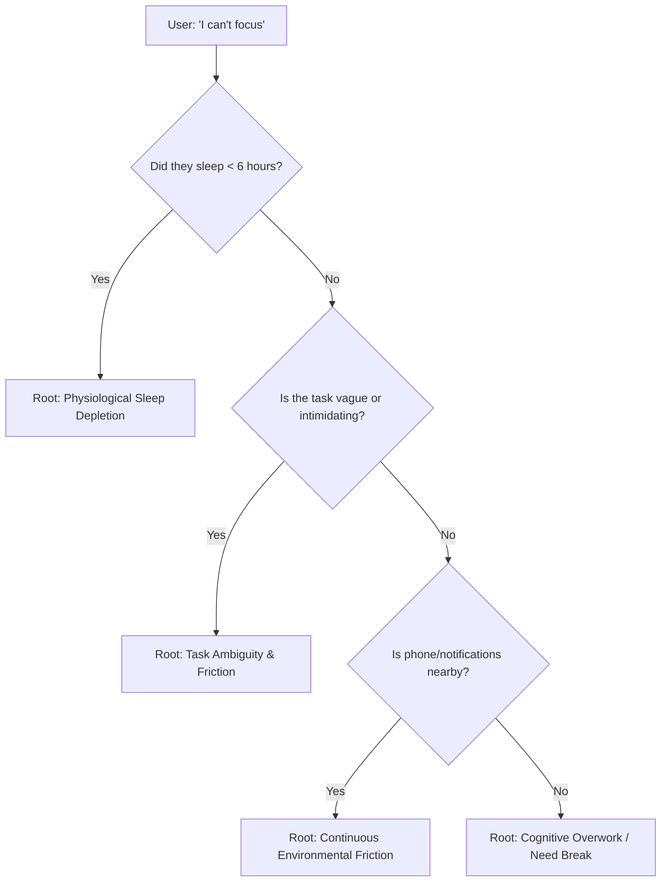

# ProductivAI Troubleshooting & Intervention Guide

When users express frustration like *"I can't focus"*, *"I wasted my whole day"*, or *"I keep getting distracted by Instagram"*, **do not overwhelm them with a 10-point lecture**. Use this diagnostic guide to find the root bottleneck and prescribe a single immediate action.

---

## Diagnostic Tree 1: "I Can't Focus Today"

Identify which of these 4 root causes is active:

### Immediate Interventions:
- **If Root A (Sleep Depletion)**: Lower the day's expectations. Protect 2 priority hours, take a 20-min power nap, drink cold water, and schedule an early bedtime tonight.
- **If Root B (Task Ambiguity)**: Use the **Micro-Slice Protocol**: "Take the task and write down only the first 2-minute step (e.g. open the doc and write 1 sentence). Do only that."
- **If Root C (Environmental Friction)**: Physical separation: Put the phone in another room or inside a drawer. Out of sight reduces involuntary dopamine impulses by 60%.
- **If Root D (Overwork / Burnout)**: Prescribe a mandatory 15-minute off-screen break (walk, stretch, no podcast, no screen).

---

## Diagnostic Tree 2: "I Waste Hours Doomscrolling"

### Why It Happens:
Algorithmic feeds prey on momentary boredom or cognitive resistance when transitioning between tasks.

### 3-Step De-Escalation Protocol:
1. **Remove Frictionless Access**:
   - Turn on smartphone **Grayscale mode** (makes screens visually unrewarding).
   - Log out of mobile apps or use an app timer set to 30 mins max.
2. **The "Phone in Another Room" Rule**:
   - During active study or work blocks, the phone must be charging outside physical arm's reach.
3. **Replacement Habit**:
   - When the impulse to pick up the phone strikes, replace it with a 30-second physical reset: stand up, drink water, take 3 deep breaths.

---

## Diagnostic Tree 3: "I Study for Hours but Accomplish Nothing"

### Why It Happens:
**Passive Consumption Trap**: Reading textbooks, highlighting notes, or watching YouTube tutorials feels like work, but creates minimal active recall or synaptic encoding.

### The Fix:
- Shift from **Passive Review** to **Active Recall**:
  - Closed-book summary: Close the notes and write down everything remembered for 5 minutes.
  - Practice questions / Past exam papers first, reading theory only to fill gaps.
  - Teach-it-back (Feynman technique): Explain the concept in simple terms to an imaginary 10-year-old.

---

## The 5-Minute Emergency Activation Protocol

When a user is completely stuck, frozen in procrastination, or overwhelmed by a mountain of work, guide them through this exact script:

1. **Timer**: Set a timer for **5 minutes**.
2. **Commitment**: Agree that after 5 minutes, they have full permission to stop and do whatever they want.
3. **Execution**: Work on the smallest piece of the task until the timer rings.
4. **Result**: In 85% of cases, the hardest barrier is task initiation; once momentum is initiated, users naturally continue.

